# Imagens sintéticas e modelos: onde estão e como foram feitos

**Para quem vai avaliar o repositório.** Esta página responde três perguntas: **que imagens foram usadas e como foram geradas**, **qual modelo foi treinado com elas**, e **quais modelos foram usados para avaliá-las**. Resumo: **nenhuma foto de pessoa e nenhum dado de atleta foram usados**. Todas as imagens são **desenhadas por código nosso**, com rótulo certo por construção. Por isso **todo número aqui é N1** (desenho sintético) e **não vale para fotos reais**.

## 1. Como as imagens são geradas

Tudo é `numpy`, sem biblioteca de imagens e sem banco de imagens. O código está em `src/para_triage/consistency/`:

| Arquivo | O que faz |
|---|---|
| [`mannequin.py`](../src/para_triage/consistency/mannequin.py) | **Nível 1.** Um boneco desenhado em vetor (SVG) e rasterizado em PNG de 400x280. Os atributos são os níveis de cada membro (perna esquerda e direita, braço esquerdo e direito), com aparência variada (cores, fundo). |
| [`level2.py`](../src/para_triage/consistency/level2.py) | **Nível 2.** Imagens sintéticas mais difíceis, com variação de pose, oclusão, iluminação, geometria, fundo, ruído, compressão tipo JPEG e equipamento (cadeira de rodas, prótese), em **4 faixas de dificuldade** (a faixa 0 é o controle, parecida com o nível 1; a 3 é a mais forte). Onde o fim de um membro não aparece (coberto, cortado, escondido pela cadeira), o rótulo da imagem é `?`. |
| [`schema.py`](../src/para_triage/consistency/schema.py) | O esquema fechado de atributos: pernas 0 a 3 (nenhum, pé parcial, abaixo do joelho, no joelho ou acima), braços 0 a 2 (nenhum, punho ou abaixo do cotovelo, cotovelo ou acima), cadeira e prótese (sim, não), e `?` para o que não se pode ver. |
| [`dataset.py`](../src/para_triage/consistency/dataset.py), [`difficulty.py`](../src/para_triage/consistency/difficulty.py) | Combinações de rótulos e a medida de dificuldade por imagem. |

**Para o experimento imagem contra formulário** (a rede treinada), o script [`spikes/imagem_formulario/make_data.py`](../spikes/imagem_formulario/make_data.py) chama esses geradores com sementes novas (treino 1000, desenvolvimento 2000, teste 3000) e produz **18.000 imagens**: por nível, 6.000 de treino, 1.000 de desenvolvimento e 2.000 de teste. As 144 combinações de nível aparecem também no nível 2, e **12 combinações ficam fora do treino** para o teste de generalização (divisão em [`splits.py`](../spikes/imagem_formulario/splits.py)). Cada imagem é reduzida de 400x280 para 200x140 para o treino ser rápido em CPU.

### Exemplos (geradas pelo nosso código, do conjunto de teste)

Cada imagem mostra **um boneco sintético**, não uma pessoa. A tabela traz o que o gerador construiu e o rótulo da imagem; `?` marca o que a imagem não deixa ver. Pernas: 0 nenhum, 1 pé parcial, 2 abaixo do joelho, 3 no joelho ou acima. Braços: 0 nenhum, 1 punho ou abaixo do cotovelo, 2 cotovelo ou acima.

| Imagem | Nível e faixa | Pernas (esq / dir) e braços (esq / dir), como construído | Cadeira, prótese | Rótulo da imagem onde difere |
|---|---|---|---|---|
| 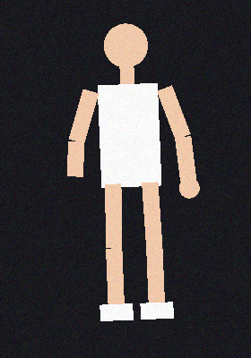 | nível 1 | 0 / 0  e  0 / 1 | n/a | igual |
| 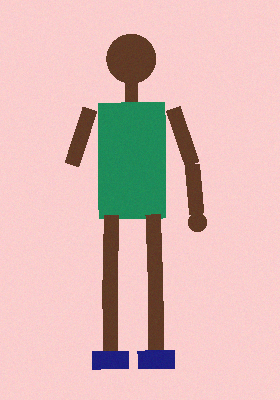 | nível 1 | 0 / 0  e  0 / 2 | n/a | igual |
| 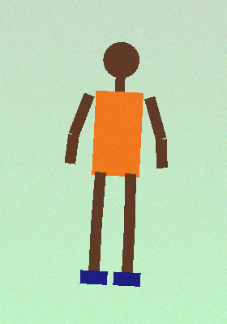 | nível 1 | 0 / 0  e  1 / 1 | n/a | igual |
| 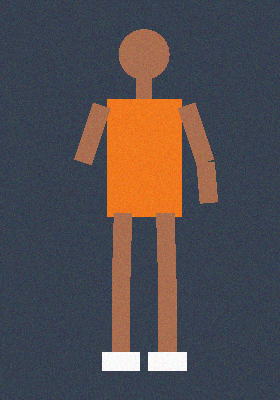 | nível 1 | 0 / 0  e  1 / 2 | n/a | igual |
| 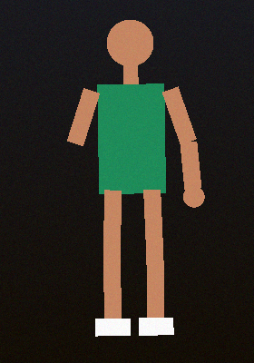 | nível 2, faixa 0 | 0 / 0  e  0 / 2 | no, no | igual |
| 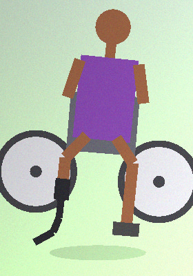 | nível 2, faixa 1 | 0 / 2  e  2 / 2 | yes, yes | igual |
| 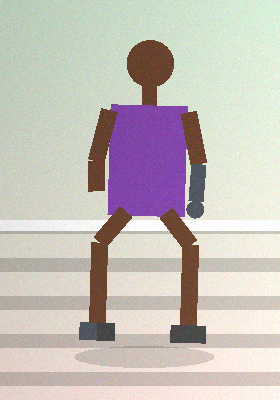 | nível 2, faixa 1 | 0 / 1  e  2 / 1 | no, yes | igual |
| 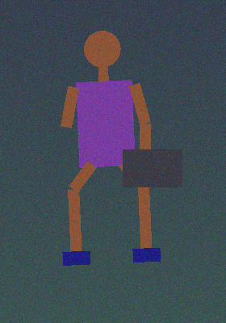 | nível 2, faixa 1 | 0 / 0  e  0 / 2 | no, no | upper_left: `?` |
| 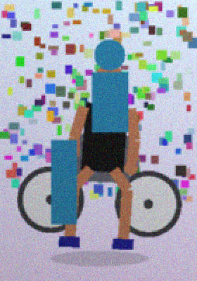 | nível 2, faixa 2 | 0 / 0  e  0 / 1 | yes, no | upper_right: `?` |
| 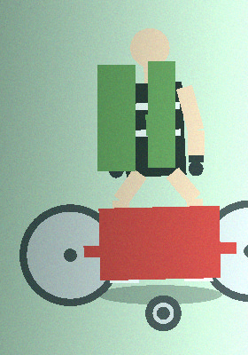 | nível 2, faixa 2 | 0 / 0  e  1 / 1 | yes, yes | lower_left: `?`, lower_right: `?`, upper_right: `?` |
| 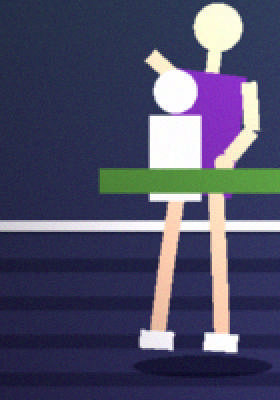 | nível 2, faixa 2 | 0 / 0  e  0 / 2 | no, no | igual |
| 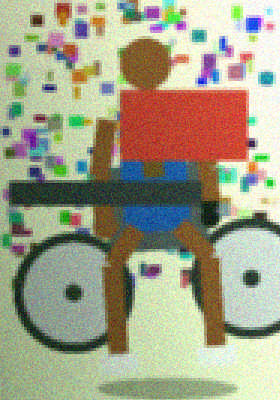 | nível 2, faixa 3 | 0 / 0  e  1 / 0 | yes, yes | igual |
| 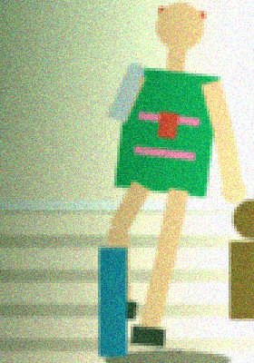 | nível 2, faixa 3 | 0 / 0  e  0 / 2 | no, yes | lower_right: `?` |
| 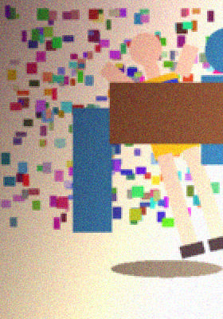 | nível 2, faixa 3 | 0 / 0  e  2 / 2 | no, no | lower_left: `?` |

As imagens têm 400x280 pixels e ficam em `docs/exemplos-imagens/`.

## 2. O modelo treinado com essas imagens (experimento imagem contra formulário)

- **O que é:** uma rede convolucional pequena, de cinco blocos (3x3, normalização em lote, ReLU, pooling), com uma camada comum e **seis cabeças**: os quatro membros (níveis e `?`), cadeira de rodas e prótese. **982.888 parâmetros**, treinada em **CPU** em 109 minutos. Código: [`spikes/imagem_formulario/net.py`](../spikes/imagem_formulario/net.py) (rede) e [`train.py`](../spikes/imagem_formulario/train.py) (treino). Uma imagem espelhada tem esquerda e direita trocadas no rótulo (com teste unitário).
- **Os pesos estão neste repositório:** [`docs/modelo-imagem/semente0.pt`](modelo-imagem/semente0.pt) e [`semente1.pt`](modelo-imagem/semente1.pt) (3,9 MB cada; a semente 1 é a replicação), mais o registro de cada treino ([`semente0.json`](modelo-imagem/semente0.json), [`semente1.json`](modelo-imagem/semente1.json): curva de treino, tempo, memória, parâmetros). Os pesos são só de dados sintéticos.

| Arquivo | SHA-256 |
|---|---|
| `semente0.pt` | `361a5785656f1959b9808214694478f4cc9bea9b759103a0b2d9620578487f9a` |
| `semente1.pt` | `4bcfa7e612179048fff65076f828fab3d70879432c4a325f545016ed91ef709c` |

### Ficha técnica da rede

| Item | Valor |
|---|---|
| **Entrada** | imagem RGB de 200 (altura) por 140 (largura), `uint8` reduzido por média de 2x2 a partir de 400x280; convertida para `float` em [-0,5; 0,5] |
| **Corpo** | 5 blocos de convolução 3x3 (sem viés) + normalização em lote + ReLU + max pooling 2x2, com 16, 32, 64, 96 e 128 canais. O mapa final (6 x 4 x 128 = 3.072 valores) é **achatado, não promediado**, para a posição na figura sobreviver e a esquerda se distinguir da direita |
| **Pescoço** | dropout 0,3, camada linear 3.072 → 256, ReLU, dropout 0,3 |
| **Cabeças (6, camadas lineares 256 → classes)** | `lower_left` e `lower_right`: 5 classes (níveis 0 a 3 e `?`); `upper_left` e `upper_right`: 4 classes (níveis 0 a 2 e `?`); `wheelchair` e `prosthesis`: 3 classes (sim, não, `?`) |
| **Parâmetros** | 982.888 (convoluções e normalização: 190.032; camada linear do pescoço: 786.688; seis cabeças: 6.168) |
| **Perda** | entropia cruzada somada nas seis cabeças e dividida pelo número de rótulos que contam; no nível 1 as cabeças de cadeira e prótese não têm perda (o boneco não tem as duas) |
| **Otimização** | Adam, taxa de aprendizado máxima 2e-3 com ciclo único (`OneCycleLR`), lote 64, 20 épocas, parada por paciência 6 sobre o acerto médio dos quatro membros **no conjunto de desenvolvimento** (na semente 0 a parada não disparou); melhor época pelo desenvolvimento (16 na semente 0, 19 na semente 1) |
| **Aumento de dados** | espelhar a imagem na horizontal **trocando esquerda e direita no rótulo** (cadeira e prótese não mudam; há teste unitário) e variação de brilho de até ±10% |
| **Dados de treino** | 6.000 imagens do nível 1 e 6.000 do nível 2 (uma só rede para os dois níveis), 132 das 144 combinações de nível; 12 combinações ficam fora do treino e do desenvolvimento |
| **Treino** | CPU, 10 threads, 108,9 min (semente 0, máquina dividida com outra rodada) e 35,9 min (semente 1, máquina livre); pico de RAM de 4.030 MB (semente 0) e 3.447 MB (semente 1) |
| **Máquina e ambiente** | Intel Core Ultra 5 125H, 15,6 GB de RAM, sem GPU; Python 3.12, `torch` 2.15.0 (CPU), `numpy` 2.5.4 |
| **Leitura (inferência)** | cerca de 9 ms por imagem em CPU |
| **Saída** | probabilidades (softmax) por cabeça; a confiança da rede é bem calibrada (ECE de 0 a 0,044 no teste) |
| **Resultado no desenvolvimento** | acerto médio dos quatro membros de 91,24% nas duas sementes (N1). Resultados no teste, com intervalos e limites: [relatório do experimento imagem contra formulário](imagem-contra-formulario-relatorio.md) |
| **Sementes** | de treino 0 e 1; de dados 1000 (treino), 2000 (desenvolvimento), 3000 (teste) |

O que a rede **não** é: não lê foto real (nunca viu uma), não lê acuidade, QI nem medidas, e não decide classe. A classe sai das regras do projeto, a partir dos atributos que a rede estima, e é sempre "sujeita à classificação oficial".

- **Como carregar** (arquivo de pesos puro, sem código embutido):

```python
import torch
from imagem_formulario.net import SmallNet          # com PYTHONPATH=src;spikes
model = SmallNet()
model.load_state_dict(torch.load("docs/modelo-imagem/semente0.pt", map_location="cpu", weights_only=True))
model.eval()
```

- **O que foi medido, contra o quê:** a rede é comparada com a **regra clássica de pixels** (sem aprendizado, [`baselines.py`](../src/para_triage/consistency/baselines.py)) e com o **preenchimento do formulário** (completo, com campos faltando, com erros), com quatro hipóteses escritas antes de rodar e o teste aberto uma única vez. Relatório completo, com os limites: [`docs/imagem-contra-formulario-relatorio.md`](imagem-contra-formulario-relatorio.md).

## 3. Os modelos usados para avaliar as imagens (experimento imagem e laudo)

Antes do experimento imagem contra formulário, testamos se **modelos abertos já prontos** conseguem ler esses bonecos e conferi-los com um laudo em texto. **Esses modelos não estão no repositório** (são arquivos de gigabytes, baixados dos repositórios oficiais; ficam fora de propósito). Fonte, versão e SHA-256 de cada arquivo estão na **tabela da seção "Passo A: a seção 6.4, os downloads"** do relatório [`docs/consistencia-imagem-laudo-relatorio.md`](consistencia-imagem-laudo-relatorio.md). Em resumo:

| Papel | Modelo | Fonte | Licença |
|---|---|---|---|
| Lê a imagem (rápido) | SmolVLM2-2.2B-Instruct, Q4_K_M | `huggingface.co/ggml-org/SmolVLM2-2.2B-Instruct-GGUF` | Apache-2.0 |
| Lê a imagem (forte) | Qwen2.5-VL-7B-Instruct, Q4_K_M | `huggingface.co/ggml-org/Qwen2.5-VL-7B-Instruct-GGUF` | Apache-2.0 |
| Lê o laudo (texto) | Qwen2.5-1.5B-Instruct, Q4_K_M | `huggingface.co/Qwen/Qwen2.5-1.5B-Instruct-GGUF` | Apache-2.0 |
| Linha de base zero-shot | OpenCLIP ViT-B/32 (LAION) | `huggingface.co/laion/CLIP-ViT-B-32-laion2B-s34B-b79K` | MIT |
| Servidor local | llama.cpp, release `b12125`, CPU | `github.com/ggml-org/llama.cpp` | MIT |

O código que roda tudo isso está em [`spikes/imagem_laudo/`](../spikes/imagem_laudo/) (`run_models.py`, `extractors.py`, `llama_client.py`, `prompts.py`, `clip_baseline.py`). **Resultado (negativo, N1):** esses modelos não leram nível nem lado do boneco, e o CLIP dá a mesma resposta na imagem espelhada. Detalhes no relatório.

## 4. O que não está no repositório, e por quê

| O quê | Onde fica | Por quê |
|---|---|---|
| As 18.000 imagens de treino, desenvolvimento e teste (cerca de 2,3 GB) | Fora do repositório | Tamanho; **regeneráveis** com o código e as sementes (cerca de 19 minutos) |
| Os modelos abertos do experimento imagem e laudo (SmolVLM2, Qwen, CLIP, llama.cpp) | Fora do repositório | Tamanho (gigabytes) e licença de cada um; baixados item a item |
| Fotos reais | **Não existem** | O nível 3 do experimento imagem e laudo (30 fotos Creative Commons) ficou como próximo passo |

## 5. Como reproduzir

Com o ambiente que tem `torch` e `numpy` (o código não depende de `pyyaml` neste trecho) e `PYTHONPATH=src;spikes`:

```bash
python -m imagem_formulario.make_data --workers 8      # gera as 18.000 imagens (cerca de 19 min), fora do repositório
python -m imagem_formulario.train --epochs 20          # treina a rede em CPU (cerca de 109 min)
python -m imagem_formulario.dev --name run1            # medidas no desenvolvimento (nunca no teste)
python -m imagem_formulario.final --name run1          # a rodada única no teste; recusa uma segunda
python -m imagem_formulario.replicate --first run1 --second run2   # replicação com a semente 1
```

## 6. Ordem de leitura sugerida

1. Esta página. 2. [`docs/consistencia-imagem-laudo-relatorio.md`](consistencia-imagem-laudo-relatorio.md): o experimento imagem e laudo, negativo. 3. [`docs/imagem-contra-formulario-relatorio.md`](imagem-contra-formulario-relatorio.md): o experimento imagem contra formulário, com as quatro hipóteses e os limites.
